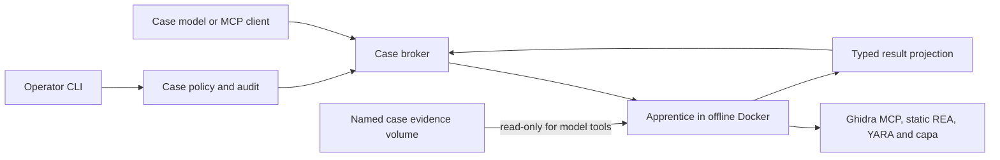

# Interception and containment

The control plane applies the task-scoped admission and pre-dispatch review pattern documented by ARTEX to offline artifact analysis. Here the target is an exact SHA-256 in a case manifest and the decision is deterministic. Missing policy state, expired grants, audit errors, provider errors and invalid outputs stop the affected request. [ARTEX interception and operation-review changelog](https://github.com/BaaRai/ARTEX/blob/main/CHANGELOG.md#0313---2026-09-19).

| Interception point | Enforced behavior |
| --- | --- |
| MCP request | Bounded JSON lines, duplicate-key rejection, exact tool and field names, bounded numeric selectors and per-session call budget |
| Scope | One case, pinned local Linux image, labeled case volume, checked artifact membership and SHA-256, and a fresh pause and closure check |
| Provider | Fixed subprocess arguments and static operations only. No arbitrary provider tool name, command, URL, path or script can be supplied by a model. YARA rules come only from an operator import pinned by SHA-256, with includes off and a module allowlist |
| Container | No external network, ports, host bind mounts, Docker socket, elevated privileges, ambient capabilities or proxy credentials. The root filesystem is read-only. Scratch is bounded and disposable |
| Disclosure | An independent host-side projection validates structured results. Approved excerpts have exact audience and expiry, a data label, and a hard size limit |
| Audit | A durable pre-dispatch record is mandatory. Audit keeps validated selectors, versioned scope decisions and outcomes. It omits sample text, model prompts and credentials |

Published capabilities do not include execution, emulation, debugger attachment, shell commands, arbitrary scripts, program mutation, C2 traffic, network scanning or upload. Treat parser responses as data. The broker admits only a closed set of static operations and carries no model API keys in the analysis container. Docker seccomp is left at its engine default and `no-new-privileges` and dropped capabilities apply to all workers.

The Forge app adds two operator-only paths, and both reach models only through the broker:

- **Sample upload:** an upload streams the bytes to a mode-0600 temporary file in the state directory, ingests them into the case's offline volume through the same operator `ingest` path, then deletes the temporary file. The app never serves sample bytes back.
- **Chat:** the model is a configured endpoint, and the Forge host makes the provider call. Every tool call goes through `server.Broker` with the case's role and tool allowlist, so the model sees only projected results and excerpts covered by an active grant for its audience (`local` for private endpoints, `mcp` for cloud).
- **Chat replay:** model text can quote an excerpt it was shown, so the Forge stamps each assistant message with its audience and every grant whose excerpts it may quote: the grants its turn released, plus those of the earlier text it was shown. A later turn replays an earlier answer only while every one of those grants is still active for the current model's audience. Otherwise the model gets a placeholder saying the text was withheld. Messages from before this stamping are withheld too. An expired, revoked or local-only grant therefore never reaches a cloud model through the conversation history, and clearing the chat stays available.
- **Data boundary:** every successful tool result reaches a model between `<<<UNTRUSTED_TOOL_OUTPUT nonce=N>>>` and `<<<END_UNTRUSTED_TOOL_OUTPUT nonce=N>>>` markers, with a fresh random nonce per result and a closing note that the block is data. Inside the data, the marker stem is rewritten with hyphens at the same length, so a sample can neither forge a marker nor close the block early. Broker refusals stay unframed because they are platform text. Each carries fixed guidance chosen by its reason code, never text from the reply. The system prompt is the role body followed by a code-owned tail (the data rule, grant-request etiquette and the evidence rule), so the Forge's own text is the final instruction. The local `ask` runner uses the same envelope, guidance and tail (`re_harness/boundary.py`).
- **Grant requests:** when the broker refuses a chat model's call with `operator_excerpt_grant_required`, the Forge files a pending request for exactly that call: the tool, the broker-validated arguments and the session's audience. The model never authors the request. A host-side check first confirms the artifact is in the case manifest; a request for an unadmitted artifact, or one made while the manifest can't be read, is refused and nothing is stored. The model may attach one short reason through `note_grant_need`, only to a request its own session filed. The reason is stored as untrusted text, shown to the operator, never replayed to a model and never written to the audit. SHA-256 values and addresses in it that neither the case manifest nor the session's tool output named are flagged as unverified. Only an operator approval creates a grant, through the same `grant` path as the CLI, for exactly the denied call and audience. The audit records `grant_requested`, `grant_need_noted` and `grant_decided` with ids only, before the request store changes; if the audit fails, nothing is stored. One chat session can file at most four pending requests, and a case holds at most 64, so a steered model cannot flood the operator's queue. A repeat of a pending request is the same request, moved to the session that asked last. Requests on a closed case can be denied but not approved, and they leave the *Waiting on you* list.
- **Turn budget:** a chat turn that reaches its turn cap gets one final model step with no tools offered. The Forge dispatches nothing from it, even if the model asks for a call, and saves its summary as the answer. The summary is model text, so it is stamped for replay like any other answer.
- **Cloud models:** a cloud model is Anthropic, a public endpoint, or an Ollama `:cloud` model. It is refused until the case opts in, because projected evidence then leaves the lab.
- **API keys:** keys live in a mode-0600 file under the state directory, are never returned to the browser, and never enter an Apprentice container.

## Investigation state, evidence and proposed findings

- **Hashed evidence:** after projection, the broker stores exactly the reply it released in `<state>/cases/<case>/evidence/<sha256>.json`, before it audits the release. The SHA-256 covers the canonical JSON of the tool, its validated arguments, whether an excerpt was released, the audience it went to, and the reply. Identical releases to one audience share one file, published with a hard link so concurrent sessions cannot overwrite each other. The reply the model gets, and the `completed` audit event, carry the same `evidence_id`. A model never reads evidence back: an excerpt-bearing result reaches a model again only through a new broker call under a grant active now. The operator sees every entry on the case page. Reading an entry checks its hash, so an edited file stops resolving.
- **Case-state tools:** `case_overview`, `lead_detail`, `add_lead`, `record_observation`, `update_plan` and `propose_finding` read and write the case's investigation store (`<state>/forge/investigations/<case>.json`). They dispatch through `Broker.call` with no worker run, so they get the same session budget, role allowlist, closed, paused and scope checks, and pre-dispatch audit as sample tools. Pausing a case stops them. Their audit events hold ids, digests, addresses and a SHA-256 of any text, never the text. Every artifact they name must be in the case manifest. An `observed` observation must cite evidence from this case. Evidence that carries an excerpt can be cited only by a session whose audience holds every grant it was released under, so a model without the grant cannot test guesses about the excerpt against the reference check; models get the check's result and problem codes, not which values failed.
- **Derived fields:** the broker adds a `derived` block to `artifact_summary` replies before storing the evidence: the PE entry point's virtual address and section index, and the ELF entry in hex. It is arithmetic on validated fields only, never a judgment.
- **Facts and their sources:** as in ARTEX's fact methodology, a fact must rest on evidence. An `observed` observation cites the evidence it relies on, and the reference check (every address and SHA-256 in its text must appear in that evidence) runs on it as it does on proposals, refusing it otherwise. The Forge, not the model, records each fact's source from the cited evidence: `sample_content` for content the sample's author controls (string text, import and section names, YARA-matched bytes), `tool_output` for the tools' own results (header facts, capa verdicts, Ghidra's functions, cross-references and decompilation), and `inference` for a fact with no evidence. Proposals may cite observations by id, which brings their evidence along, so a finding rests on facts and facts on evidence. Like ARTEX's `prove_goal`, which never accepts a `target_response` fact, `propose_answer` refuses an answer whose proposals rest only on `sample_content`.
- **Excerpt rule for stored model text:** each lead, observation, plan and proposal is stamped with the audience of the session that wrote it and every grant that session's text may quote, including grants inherited from replayed chat. Reading it back, a model gets the text only while all of those grants are active for its own audience. Otherwise it gets a withheld placeholder. Text a read shows adds its grants to the reading session, so whatever that session writes next, in the store or the chat, carries them too. Cited excerpt evidence adds its grants the same way.
- **Proposed findings:** `propose_finding` writes a candidate, never a ledger row. A deterministic check runs on it: cited evidence exists in this case and matches its hash, cited artifacts are admitted, no unadmitted SHA-256 is named, every address in the claim appears in a cited evidence object, and an observed or corroborated claim cites evidence. The check's label is *references resolve*, not *verified*. An optional review run is a separate session with the review role's tools, the review contract, and one verdict (`supported`, `unsupported` or `insufficient`) keyed to the candidate by the Forge. A reviewer whose audience lacks the candidate's grants is refused. Neither the check nor the verdict records, promotes or labels anything. Only the operator records a candidate, through the same `finding` path as the CLI, after reading and optionally editing it, or rejects it. Recording first claims the candidate, so a second record or a reject cannot reach the ledger too; a failed recording returns it to proposed. The check counts an address only when a cited evidence object shows it in an address field, a hex literal or a default label such as `FUN_00405a10`, never from counts or sizes.
- **Questions:** questions are operator text. A model may propose sub-questions from a question's text alone, with no tools. They stay `proposed` until the operator accepts them.

- **Skills:** a chat model can load the body of a skill its role may see with `load_skill`. Bodies are the git-reviewed `.agents/skills/*/SKILL.md` files, returned as platform text. They are read-only and never change tools, grants or policy. Loads and misses are audited by skill name only, and misses are kept as a skill-gaps list. ARTEX's skill-gated unlocking of extra tools is not used: the tool set stays closed.
- **Outcome card:** `GET api/cases/{id}/outcome` counts audit decisions, grants, proposals and tokens. It reads metadata only.

- **Investigation runs:** the planner gets case-state tools and three local tools that write only the investigation store (`retire_lead`, `propose_answer`, `state_need`), and no sample tools. Its local tools take the broker's stop check and call budget and are audited with ids and text hashes before they write, and they refuse once the run stops. Lead workers use their role's tools, narrowed by the case's tool allowlist, through `Broker.call`, each session with its own 32-call budget. Every run transition (queued, running, paused, waiting, settling, answered, exhausted, failed, cancelled) is a guarded write audited as `investigation_transition`, with ids only, before it is saved. `propose_answer` is refused unless every cited proposal's reference check passed and cites an artifact the question names, and it only marks the question *answer proposed*. Only the operator closes a question, and a run is answered only when the operator has closed every one of its questions. The settle turn is offered no tools and nothing is dispatched from it. Lead wrap-ups, the planner's stated need and the settle summary are model text, stamped with their audience and grants. A lead's text reaches a later model only while those grants are active for that model's audience, and SHA-256 values and addresses in a stated need that the case never showed are flagged. No transition, heartbeat or settle turn issues a grant, calls a sample tool outside the broker, or records a finding.

- **Side questions:** "Ask about this conversation" or "this investigation" answers from a snapshot with no tools offered, and nothing is dispatched or saved to the chat or the store. The snapshot follows the excerpt rule: chat rows, stored model text and a run's need or summary whose grants are not active for the model's audience are withheld first.
- **Linked prior cases:** the operator links up to eight cases. The Forge snapshots their current recorded findings (operator-recorded ledger rows: id, kind, confidence, a 500-character claim, artifact SHA-256 values) and `case_overview` shows them read-only, marked inherited and citing their own case. No artifact bytes, evidence or excerpt grant crosses cases. A ledger claim is operator text: link a case only if its recorded claims may be shown to this case's models.
- **Lessons:** lessons come only from closed cases' reviewed outcomes, by fixed rules, and carry action text written by the Forge, never model text. Shadow mode only audits which lessons a session would see. Inject mode shows adopted lessons to sessions that can write claims, inside the untrusted-data envelope, before the code-owned rules. A lesson is adopted only on an operator-recorded benchmark comparison that lost no recall or precision. Lessons never change tools, grants or policy.

## Residual trust and recovery

Docker isolation shares the Linux kernel. Use an independently isolated guest to host the harness when the case warrants a separate kernel boundary. Docker daemon and WSL operator privileges are trusted. A generic MCP client that has unrelated tools can make requests outside this harness. Use the built-in local client to keep the model's tool surface bounded by construction.

The local case administrator can read or alter case policy and logs. Restrict the operator account and retain copies of case audit and evidence for stronger custody. Each provider import uses a bounded disposable scratch environment. The evidence volume is read-only for model tools. Operator-mode `ingest`, `derive` and persisted `triage` write the case volume, and parser faults in those manual modes have a larger evidence-integrity impact. Verify artifacts and work from reviewed copies where higher custody assurance is needed.

An image snapshot restores the verified tooling state. Container shutdown and scratch disposal leave named evidence volumes available. A revoked grant prevents later releases from that grant. Information already delivered belongs to the receiving client and its data-handling policy.
