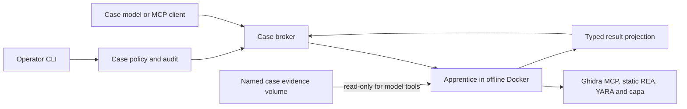

# Interception and containment

The control plane applies the task-scoped admission and pre-dispatch review pattern documented by ARTEX to offline artifact analysis. Here the target is an exact SHA-256 in a case manifest and the decision is deterministic. Missing policy state, expired grants, audit errors, provider errors and invalid outputs stop the affected request. [ARTEX interception and operation-review changelog](https://github.com/BaaRai/ARTEX/blob/main/CHANGELOG.md#0313---2026-09-19).

| Interception point | Enforced behavior |
| --- | --- |
| MCP request | Bounded JSON lines, duplicate-key rejection, exact tool and field names, bounded numeric selectors and per-session call budget |
| Scope | One case, pinned local Linux image, labeled case volume, checked artifact membership and SHA-256, and a fresh pause and closure check |
| Provider | Fixed subprocess arguments and static operations only. No arbitrary provider tool name, command, URL, path or script can be supplied by a model. YARA rules come only from an operator import pinned by SHA-256, with includes off and a module allowlist |
| Container | No external network, ports, host bind mounts, Docker socket, elevated privileges, ambient capabilities or proxy credentials. The root filesystem is read-only. Scratch is bounded and disposable |
| Disclosure | An independent host-side projection validates structured results. Approved excerpts have exact audience and expiry, a data label, and a hard size limit |
| Audit | A durable pre-dispatch record is mandatory. Audit keeps validated selectors, versioned scope decisions and outcomes. It omits sample text, model prompts and credentials |

Published capabilities do not include execution, emulation, debugger attachment, shell commands, arbitrary scripts, program mutation, C2 traffic, network scanning or upload. Treat parser responses as data. The broker admits only a closed set of static operations and carries no model API keys in the analysis container. Docker seccomp is left at its engine default and `no-new-privileges` and dropped capabilities apply to all workers.

The Forge app adds two operator-only paths, and both reach models only through the broker:

- **Sample upload:** an upload streams the bytes to a mode-0600 temporary file in the state directory, ingests them into the case's offline volume through the same operator `ingest` path, then deletes the temporary file. The app never serves sample bytes back.
- **Chat:** the model is a configured endpoint, and the Forge host makes the provider call. Every tool call goes through `server.Broker` with the case's role and tool allowlist, so the model sees only projected results and excerpts covered by an active grant for its audience (`local` for private endpoints, `mcp` for cloud).
- **Chat replay:** model text can quote an excerpt it was shown, so the Forge stamps each assistant message with its audience and every grant whose excerpts it may quote: the grants its turn released, plus those of the earlier text it was shown. A later turn replays an earlier answer only while every one of those grants is still active for the current model's audience. Otherwise the model gets a placeholder saying the text was withheld. Messages from before this stamping are withheld too. An expired, revoked or local-only grant therefore never reaches a cloud model through the conversation history, and clearing the chat stays available.
- **Data boundary:** every successful tool result reaches a model between `<<<UNTRUSTED_TOOL_OUTPUT nonce=N>>>` and `<<<END_UNTRUSTED_TOOL_OUTPUT nonce=N>>>` markers, with a fresh random nonce per result and a closing note that the block is data. Inside the data, the marker stem is rewritten with hyphens at the same length, so a sample can neither forge a marker nor close the block early. Broker refusals stay unframed because they are platform text. Each carries fixed guidance chosen by its reason code, never text from the reply. The system prompt is the role body followed by a code-owned tail (the data rule, grant-request etiquette and the evidence rule), so the Forge's own text is the final instruction. The local `ask` runner uses the same envelope, guidance and tail (`re_harness/boundary.py`).
- **Grant requests:** when the broker refuses a chat model's call with `operator_excerpt_grant_required`, the Forge files a pending request for exactly that call: the tool, the broker-validated arguments and the session's audience. The model never authors the request. A host-side check first confirms the artifact is in the case manifest; a request for an unadmitted artifact, or one made while the manifest can't be read, is refused and nothing is stored. The model may attach one short reason through `note_grant_need`, only to a request its own session filed. The reason is stored as untrusted text, shown to the operator, never replayed to a model and never written to the audit. SHA-256 values and addresses in it that neither the case manifest nor the session's tool output named are flagged as unverified. Only an operator approval creates a grant, through the same `grant` path as the CLI, for exactly the denied call and audience. The audit records `grant_requested`, `grant_need_noted` and `grant_decided` with ids only.
- **Turn budget:** a chat turn that reaches its turn cap gets one final model step with no tools offered. The Forge dispatches nothing from it, even if the model asks for a call, and saves its summary as the answer. The summary is model text, so it is stamped for replay like any other answer.
- **Cloud models:** a cloud model is Anthropic, a public endpoint, or an Ollama `:cloud` model. It is refused until the case opts in, because projected evidence then leaves the lab.
- **API keys:** keys live in a mode-0600 file under the state directory, are never returned to the browser, and never enter an Apprentice container.

## Residual trust and recovery

Docker isolation shares the Linux kernel. Use an independently isolated guest to host the harness when the case warrants a separate kernel boundary. Docker daemon and WSL operator privileges are trusted. A generic MCP client that has unrelated tools can make requests outside this harness. Use the built-in local client to keep the model's tool surface bounded by construction.

The local case administrator can read or alter case policy and logs. Restrict the operator account and retain copies of case audit and evidence for stronger custody. Each provider import uses a bounded disposable scratch environment. The evidence volume is read-only for model tools. Operator-mode `ingest`, `derive` and persisted `triage` write the case volume, and parser faults in those manual modes have a larger evidence-integrity impact. Verify artifacts and work from reviewed copies where higher custody assurance is needed.

An image snapshot restores the verified tooling state. Container shutdown and scratch disposal leave named evidence volumes available. A revoked grant prevents later releases from that grant. Information already delivered belongs to the receiving client and its data-handling policy.
